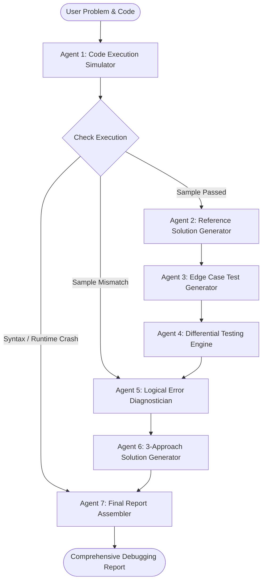

<div align="center">

# 🧠 CodeMentor AI
### Autonomous Multi-Agent Code Debugging & Differential Analysis System

[](https://fastapi.tiangolo.com/)
[](https://github.com/langchain-ai/langgraph)
[](https://groq.com/)
[](https://vercel.com/)
[](LICENSE)

<p align="center">
  <b>A state-of-the-art AI pair programmer that simulates code execution, synthesizes reference solutions, performs differential testing on generated edge cases, pinpoints exact logical bugs, and formulates 3 optimal solution approaches.</b>
</p>

</div>

---

## 🌟 Key Features

### 1. Dual Problem Input Modes
- **Option 1: 🔗 From Problem Link (LeetCode & Online Judges)**
  - Paste any LeetCode problem link (e.g. `https://leetcode.com/problems/climbing-stairs-ii/`).
  - Automatically fetches and parses:
    - Complete problem statement and constraints
    - Sample input and expected sample output
    - Python starter snippet (`class Solution: ...`)
  - **The developer only needs to paste or write their solution code.**
  - Pre-loaded with quick pills for popular problems (*Two Sum*, *Climbing Stairs*, *Valid Parentheses*, etc.).
- **Option 2: 📝 Manual Input**
  - Full manual input fields for custom or competitive programming problems (Codeforces, HackerRank, CodeChef).

### 2. LeetCode & Competitive Programming Compatibility
- **LeetCode Environment Support**:
  - Automatically supports `class Solution:` methods with type annotations (`List[int]`, `Optional[TreeNode]`, `Dict`).
  - Pre-imports standard library modules (`math`, `collections`, `heapq`, `bisect`) without throwing false-positive `NameError` exceptions.
  - Instantiates `Solution()` and invokes methods with parsed parameter arguments.
- **Competitive Programming (CP) Mode**:
  - Full support for stdin/stdout streams (`sys.stdin` and `print`).

### 3. Interactive Debugging Dashboard
- **Executive Badges**: Real-time indicators for Execution Status (`SUCCESS` / `ERROR`), Sample Verification (`PASSED` / `MISMATCH`), and Failed Edge Case Counts.
- **📊 Overview Tab**: Execution outputs, return values, stderr messages, and crash diagnosis.
- **🔍 Logical Analysis Tab**: Richly rendered Markdown dissecting bug root causes and line-by-line fixes.
- **🧪 Failed Testcases Tab**: Visual cards comparing Test Input, Expected Output (Reference), and Actual Output (Submitted).
- **💡 3 Solutions Tab**: Formulates **Brute Force**, **Better Approach**, and **Optimal Approach** with time/space complexities and 1-click code copy buttons.
- **📦 Raw JSON Tab**: Formatted API response viewer for debugging.

---

## 🔄 Multi-Agent Workflow Architecture

CodeMentor AI leverages **LangGraph** to coordinate seven specialized agents:



| Agent | Responsibility |
|---|---|
| **Agent 1: Execution Agent** | Simulates runtime execution in LeetCode/CP environment and predicts output. |
| **Agent 2: Reference Solution Agent** | Generates an authoritative, correct reference implementation. |
| **Agent 3: Test Case Generator** | Synthesizes 3–5 diverse edge, boundary, and extreme test cases. |
| **Agent 4: Differential Testing Agent** | Runs both submitted and reference code on generated test cases to catch subtle logical regressions. |
| **Agent 5: Logical Error Agent** | Pinpoints the exact flawed logic, edge cases missed, and explains how to fix it. |
| **Agent 6: Solution Generation Agent** | Generates 3 approaches: **Brute Force**, **Better**, and **Optimal** with time & space complexities. |
| **Agent 7: Final Report Agent** | Formats the consolidated response payload for the UI. |

---

## 🛠️ Tech Stack

- **Backend**: [FastAPI](https://fastapi.tiangolo.com/), [LangGraph](https://github.com/langchain-ai/langgraph), [Pydantic v2](https://docs.pydantic.dev/), [Uvicorn](https://www.uvicorn.org/)
- **LLM Engine**: [Groq Cloud](https://groq.com/) using `openai/gpt-oss-120b` (sub-second inference speed)
- **Frontend**: Vanilla HTML5, [Tailwind CSS](https://tailwindcss.com/), [Marked.js](https://marked.js.org/), [Highlight.js](https://highlightjs.org/), Font Awesome
- **Deployment**: [Vercel](https://vercel.com/) (Serverless Python `@vercel/python` + Static Frontend)

---

## 📁 Repository Structure

```
.
├── api/
│   └── index.py            # Vercel Serverless Function entry point
├── backend/
│   ├── main.py             # FastAPI application & API endpoints
│   ├── nodes.py            # 7 LangGraph debugging agents
│   ├── graph.py            # LangGraph StateGraph pipeline
│   ├── extractor.py        # LeetCode GraphQL & web problem scraper
│   ├── structured_helper.py# Resilient structured output helper for Groq
│   ├── llm.py              # Groq ChatGroq LLM initialization
│   ├── state.py            # CodeState TypedDict definition
│   └── requirements.txt    # Backend dependencies
├── frontend/
│   ├── index.html          # Main web application dashboard
│   ├── styles.css          # Dark UI styling & custom animations
│   ├── app.js              # Client state, extraction, rendering & shortcuts
│   ├── server.py           # Optional standalone Python static server (port 3000)
│   └── README.md           # Frontend-specific documentation
├── .gitignore              # Ignores .env, virtual environments & caches
├── DEPLOYMENT.md           # Step-by-step Vercel deployment guide
├── requirements.txt        # Root dependencies for Vercel deployment
├── test.py                 # CLI test script for API verification
└── vercel.json             # Vercel serverless routing configuration
```

---

## 🚀 Getting Started Locally

### Prerequisites
- Python 3.10+
- A free [Groq API Key](https://console.groq.com/keys)

### 1. Clone the Repository
```bash
git clone https://github.com/Mohamedfariq/codedebug-agentic-ai-practice.git
cd codedebug-agentic-ai-practice
```

### 2. Set Up Virtual Environment & Dependencies
```bash
python -m venv venv
# On Windows (PowerShell):
.\venv\Scripts\Activate.ps1
# On macOS / Linux:
source venv/bin/activate

pip install -r requirements.txt
```

### 3. Configure Your Environment
Create a `.env` file in `backend/.env` (or project root):
```env
GROQ_API_KEY=gsk_your_groq_api_key_here
```

### 4. Run the Application
Start the unified FastAPI server (serves both API and Frontend):
```bash
python -m uvicorn main:app --app-dir backend --reload --port 8000
```
Open your browser at:
👉 **`http://127.0.0.1:8000`**

---

## ☁️ Deploying to Vercel

The repository is pre-configured with [`vercel.json`](vercel.json) and [`api/index.py`](api/index.py) for 1-click deployment.

1. Push your repository to GitHub.
2. Go to [vercel.com](https://vercel.com/) &rarr; **Add New Project** &rarr; Import your repo.
3. In **Environment Variables**, add:
   - **Key**: `GROQ_API_KEY`
   - **Value**: Your Groq API key (`gsk_...`)
4. Click **Deploy**. Your app will be live with full serverless functionality!

For advanced deployment instructions, see [`DEPLOYMENT.md`](DEPLOYMENT.md).

---

## 📄 License

This project is licensed under the [MIT License](LICENSE).
